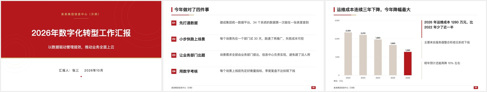
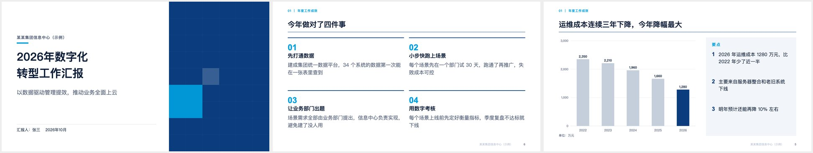
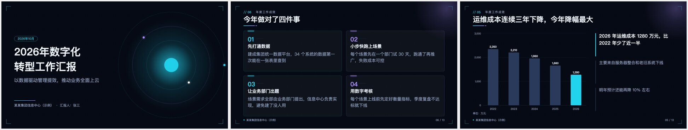
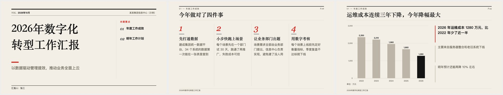
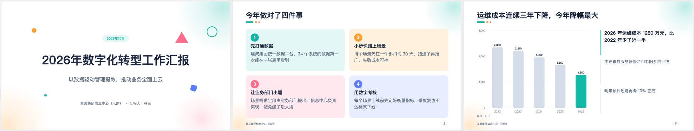
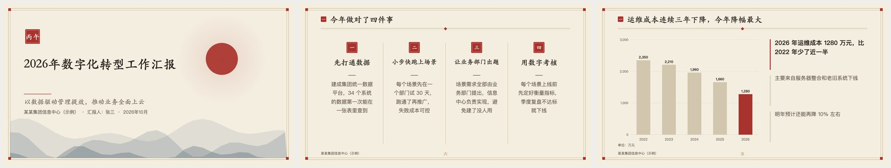

# haitao-ppt-maker

把文章、Word 材料、旧 PPT 或一个主题，交给 AI 做成一份排版规范、画面精美的 PPT。
同时导出两种文件：**可编辑的 .pptx**（企业汇报用）和**带动效的 HTML 演示稿**（发布会、科技主题用）。

这是一个 Agent 技能（Skill），在腾讯 WorkBuddy 里导入即用，**不需要安装任何软件**；也可以在 Claude Code、Codex 等支持技能的智能体里使用。

## 六套风格

不是换颜色，而是版式、装饰、字体都不一样。同一份内容可以随时换风格重新生成。

**政务红** `zhengwu`：庄重对称，红色主色、金线点缀、方角卡片。适合机关单位、国企、党建、年度工作汇报。


**商务咨询蓝** `zixun`：咨询报告风，标题写结论、细线分区、图表只高亮重点。适合方案汇报、经营分析、项目提案。


**科技暗黑** `keji`：深色网格、青紫发光线条；HTML 版有扫描线、光晕呼吸、轨道旋转。适合 AI 与数字化主题、产品发布、路演。


**杂志墨水** `zazhi`：米色纸张、宋体大标题、斜体大号数字，靠留白取胜。适合观点分享、品牌故事、内刊。


**清新活力** `qingxin`：马卡龙四色、大圆角卡片、彩色圆形编号。适合培训课件、活动策划、校园主题。


**新中式** `guochao`：宣纸底、楷体标题、印章编号、层叠远山。适合文化宣传、文旅、传统节日。


`samples/` 目录里有六套风格的完整样张（pptx 和 html 各一份），可以直接下载打开看。

## 它和别的 PPT 工具有什么不一样

- **模型只写内容，排版交给程序。** 中等水平的模型也能稳定出效果，不会出现文字溢出、元素重叠。
- **字放不下不会偷偷缩小。** 程序会告诉模型「第几页第几条请缩短到约多少字」，模型改完重跑，直到全部放得下。
- **数字不许编。** 技能要求所有数字和事实只来自用户给的材料，缺的标成「【待补】」交给用户补。
- **元素都是原生的。** pptx 里的文字是文本框，表格是真表格，图表双击就能改数据，WPS 和 PowerPoint 都能直接编辑。
- **两种格式长得一样。** pptx 和 HTML 由同一份排版数据生成。
- **能读现成材料。** 自带工具可以读取 Word(.docx) 和旧 PPT(.pptx) 里的文字，「Word 变 PPT」「旧 PPT 换风格」一句话就行。

## 安装

**WorkBuddy**：下载 [Releases](../../releases) 里的 `haitao-ppt-maker.zip`，在 WorkBuddy 的技能管理里导入这个压缩包。

**Claude Code 等其他智能体**：把 `haitao-ppt-maker/` 文件夹复制到对应的技能目录（如 `~/.claude/skills/`）。需要本机有 Node.js（已在 Node 22 上测试），不需要 npm install。

## 怎么用

装好后直接对智能体说：

> 把这份 Word 材料做成一份 12 页左右的汇报 PPT，用政务红风格，每页带口播备注。

> 帮我把这份旧课件换成清新活力风格，内容不要改。

> 做一份介绍我们新产品的发布会 PPT，科技暗黑风格，要 HTML 版。

智能体会先给你看大纲，确认后再生成文件。

## 直接用命令行

```bash
node haitao-ppt-maker/scripts/build.js 内容.json --style keji --out 输出目录
```

- 内容文件的写法见 [content-guide.md](haitao-ppt-maker/references/content-guide.md)，完整示例见 [example.json](haitao-ppt-maker/references/example.json)。
- `--format pptx` 或 `--format html` 只出一种；`--check` 只检查不出文件；`--styles` 列出全部风格。
- 退出码 0 表示成功；2 表示文件已生成但有文字放不下（会提示怎么改）；1 表示内容格式有错。

读取 Word 或 PPT 里的文字：

```bash
node haitao-ppt-maker/scripts/extract.js 材料.docx
```

## 开发

```bash
cd dev && npm install
node build-vendor.js     # 重新打包 vendor/（含 Keynote 兼容补丁）
node capacity.js         # 字数上限压力测试：六套风格都要放得下
python3 pack.py          # 打包 dist/haitao-ppt-maker.zip
```

新增风格：在 `haitao-ppt-maker/scripts/styles/` 下加一个文件，参照现有风格导出 `theme`、`parts`（页眉、页脚、卡片、编号等零件）和需要整页重画的版式 `L`。

## 许可证

MIT License © 2026 焦海涛。打包的第三方组件（PptxGenJS、JSZip 等）的许可证见 [THIRD_PARTY_NOTICES.md](haitao-ppt-maker/THIRD_PARTY_NOTICES.md)。
